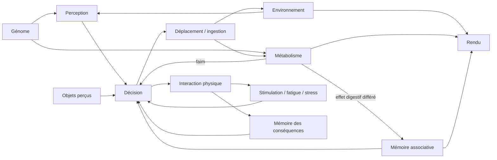

# Architecture du prototype

## Flux d’un tick

Le moteur reçoit uniquement des ticks et des commandes explicites. Il ne lit aucune horloge externe. Le rendu ne tire jamais de nombres aléatoires dans le générateur biologique. Pour un replay, enregistrer les commandes avec leur numéro de tick ; le prototype conserve l’état complet, sans encore fournir un éditeur de replay.

## Génétique

Un génome versionné contient des loci nommés. Les anciens génomes v1 conservent leur fonctionnement. Les nouveaux génomes v2 du laboratoire possèdent treize paramètres exprimés : locomotion, perception, assimilation, détoxification, plasticité, exploration alimentaire, dépense métabolique, débit digestif, sensibilité aux toxines, réponse aux stimuli, réactivité au stress, récupération et perte de stimulation. Aucun locus ne dit quel aliment ou objet apprécier.

La graine génétique est indépendante du terrain. Une transmission asexuée avec petites mutations bornées peut être demandée au laboratoire, sans transmettre les besoins ou les apprentissages. Elle ne crée aucune cohabitation ou reproduction autonome. Voir [l’audit et le laboratoire](laboratory.md) pour les intervalles, mécanismes, sauvegardes et protocoles de comparaison.

## Métabolisme

Toutes les quantités sont des unités arbitraires, sans prétention physiologique clinique.

- Énergie `E ∈ [0,100]`, santé `H ∈ [0,100]`, toxines `T ∈ [0,100]` et contenu digestif `S ∈ [0,36]`.
- Dépense énergétique : `(0,32 + 0,18 × déplacement) × Δt`.
- La digestion partage un débit total de `2,4 unités de masse/s` entre les bolus. Chaque bolus conserve ses nutriments, ses toxines et son effet cumulé restant à attribuer.
- Absorption : `ΔE = nutriments absorbés × efficacité génétique`, bornée à l’énergie maximale ; `ΔH = −1,8 × toxines absorbées`, bornée à zéro.
- Les toxines s’accumulent et diminuent au débit génétique de détoxification. Leur dommage est appliqué au moment de l’absorption ; **il n’y a pas encore de dommage secondaire lié à leur concentration sanguine**.
- Énergie quasi nulle : perte de santé de `1,6/s`. Régénération de `0,13/s` si énergie > 35 et toxines < 1.
- Faim : `(1 − E/100) × (1 − 0,7 × min(S/36,1))`.

La satiété réunit donc le remplissage digestif et la disponibilité énergétique. La digestion est différée ; l’ingestion ne crédite ni énergie ni apprentissage instantanément. Le modèle sépare ingestion et absorption, mais n’inclut pas encore d’enzymes ou de métabolites individuels.

## Apprentissage et décisions

Chaque signal alimentaire commence avec une valeur apprise `V = 0` et zéro expérience. Pendant la digestion, on cumule le changement interne effectivement causé par le bolus :

`r += ΔE/25 + ΔH/14`

Les pertes basales et la régénération indépendante ne sont pas attribuées au repas. Lorsque le bolus a fini de se digérer, son résultat borné à `[-2,2]` met à jour la mémoire :

`V(signal) ← V(signal) + taux_apprentissage × (r − V(signal))`

L’attribution par bolus est une simplification explicite du crédit temporel : le moteur connaît la cause physique du renforcement. Le système décisionnel ne connaît que le signal, la distance et la mémoire acquise. Une version plus profonde pourrait utiliser une trace d’éligibilité sensorielle et des neuromodulateurs, sans identifiant de repas dans le renforcement.

Si faim > 0,18 et contenu digestif < 25, les aliments visibles concourent selon :

`score = 1,25 × faim + V(signal) − 0,22 × distance/portée`

Le meilleur score positif est choisi. Avec une probabilité génétique de 0,12, Milo explore un aliment visible choisi uniformément. Sans choix alimentaire, il peut se reposer ou marcher vers une destination aléatoire. L’instinct de manger quand la faim monte est inné ; **la valeur d’une catégorie alimentaire ne l’est pas**. Aucun branchement de décision ne dépend de « amber », « blue » ou « rose ».

Les tests échangent la composition d’aliments portant les mêmes signaux et vérifient l’inversion des préférences. Ils vérifient aussi le désapprentissage lorsque les effets d’un signal changent. À l’étape 2, ce choix alimentaire est conservé comme candidat dans un arbitrage de motivations ; voir [curiosité et objets](curiosity.md).

## Horloge et budget mobile

Un tick dure 100 ms. Un accumulateur convertit le temps de rendu en ticks entiers. Les pauses ne modifient pas l’état. Un frame très tardif est limité à 250 ms pour éviter une avalanche de rattrapage ; ce choix ralentit le temps simulé lors d’un gel prolongé, mais ne change pas le résultat d’une séquence de ticks.

Avec une créature, au maximum 48 aliments et 12 objets, un parcours linéaire de perception est plus simple et suffisant. Ne pas introduire d’arbre spatial sans mesure. Pour une population, déplacer les ticks vers un Worker et introduire une grille spatiale avant d’augmenter la fréquence de décision. Le dessin et les informations facultatives peuvent conserver un instantané indépendant.

## Sauvegardes et évolution

Le format JSON v2 contient uniquement des données. L’import borne la taille et le nombre d’objets, vérifie valeurs finies, plages, références, identifiants uniques et cohérence du volume digestif. Les sauvegardes v1 sont d’abord validées avec leurs contraintes d’origine puis migrées sans modifier leurs champs biologiques, leur mémoire alimentaire ou leur générateur aléatoire. Les objets, besoins et traces d’interaction v2 sont validés séparément. Les versions inconnues sont rejetées. Un ancien moteur v1 ne sait pas relire les nouveaux exports v2.

Une enveloppe d’archive distincte conserve les profils du laboratoire et leurs terrains d’essai. Seul le monde actif reçoit des ticks. Les prochaines extensions possibles sont : récepteurs et signaux plus riches ; métabolites à cinétique propre ; boucles de récompense fondées sur des neuromodulateurs ; reproduction autonome et sélection. Chacune doit maintenir les tests de replay et de reprise exacte.
