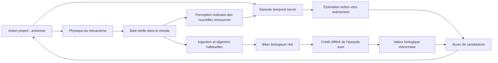

# Étape 4 — apprendre les conséquences d’une action

Cette étape met en œuvre une mémoire instrumentale limitée, guidée par le [rapport C3/DS](research/creatures3-engine-study.md) et le [contrat de l’observatoire](learning-observatory.md). Elle n’ajoute ni réseau neuronal, ni observation des actions du joueur, ni système social.

## Explication accessible

Luma sait effectuer un geste mécanique, mais ignore ce qu’il provoque. Sa curiosité peut l’amener à essayer un levier, comme elle l’amène à explorer les objets.

Si une nouvelle baie apparaît dans le voisinage et peu après son action, Luma peut retenir cette succession. Cela ne lui donne encore aucun bénéfice biologique. Elle doit approcher la baie, la manger et la digérer avec son métabolisme habituel. Le bilan effectivement vécu peut alors modifier la valeur mémorisée de l’action précédente.

Deux informations restent séparées : **« cette action est parfois suivie d’une ressource »** et **« les conséquences digérées ont cette valeur pour moi »**. Quand le levier ne produit plus rien, la première estimation peut diminuer. La baie ne devient pas mauvaise pour autant. La curiosité peut encore conduire à des essais : l’extinction n’est pas une interdiction définitive.

Le rapprochement est temporel et spatial. Ce prototype ne démontre pas que Luma comprend une causalité générale ou raisonne sur toutes les causes possibles.

## Jouer

Dans la palette **Objets**, déplier **Machine à levier**, choisir la baie fabriquée, puis **Placer une distributrice** et toucher le terrarium. Jusqu’à quatre machines peuvent être présentes. Aucune n’est ajoutée automatiquement aux anciennes sauvegardes.

Chaque machine possède une réserve de **12 baies**, un délai de production de **0,8 s** et une recharge mécanique de **8 s**. Une pression fait bouger le levier même si la réserve est vide. La machine peut être remplie avec **Recharger une machine** ou retirée avec **Retirer un objet**. Ces opérations physiques ne changent pas la mémoire de la créature.

La baie est réellement ajoutée à la liste des aliments. Sa masse, ses nutriments et ses toxines passent par l’ingestion, les bolus et l’absorption existants. La production attend si la capacité de 48 aliments est atteinte ; il n’y a pas de production infinie en arrière-plan.

L’**observatoire** expose les tentatives, les faits physiques de production, les événements perçus, les estimations apprises et le crédit biologique différé. Sa synthèse distingue valeur encore inconnue, positive, neutre ou négative. Le score de candidature n’est pas présenté comme une probabilité de sélection.

## Architecture et séparation des informations



| Module                                                  | Responsabilité                                                                           |
| ------------------------------------------------------- | ---------------------------------------------------------------------------------------- |
| `src/sim/devices.ts`                                    | Réserve, commande physique, délai, recharge et production ; aucune lecture de la mémoire |
| `src/sim/instrumental-types.ts`                         | Affordances perçues, événements, épisodes et mémoires bornés                             |
| `src/sim/instrumental.ts`                               | Projection perceptive, rapprochements, estimation, éligibilité et valeur                 |
| `src/sim/decisions.ts`                                  | Ajout des candidatures instrumentales à l’arbitrage existant                             |
| `src/sim/world.ts`                                      | Ordre des événements, commandes motrices et raccord au bilan alimentaire                 |
| `src/sim/instrumental-persistence.ts`                   | Validation de l’extension sauvegardée                                                    |
| `src/observatory/recorder.ts`, `src/ui/instrumental.ts` | Faits, relations estimées, synthèse et séries capturées                                  |
| `src/experiments/instrumental.ts`                       | Protocole scientifique reproductible, sans dépendance à l’interface                      |

Le moteur fournit une primitive motrice **actionner** pour une affordance mécanique. Cette capacité ne prédit ni nourriture, ni récompense. Les mémoires commencent sans relation ou valeur connue et ne dépendent pas d’une préférence pour une couleur, un aliment ou un nom d’individu.

La perception d’un levier contient identifiant, position, distance, apparence et geste disponible. Elle ne contient **ni stock, ni recharge, ni recette, ni nutriments, ni toxines**. Le modèle instrumental ne consulte pas ces propriétés pour noter une action.

La source physique d’une baie est disponible au diagnostic du monde, mais **pas au mécanisme de rapprochement**. Celui-ci reçoit les nouvelles ressources issues de la perception ordinaire : aliments fabriqués, ajoutés manuellement, ou entrant dans le champ de vision. Il ne bénéficie donc pas d’un canal qui sélectionnerait secrètement les seules baies de la machine. Voir une nouvelle ressource ne prouve pas qu’elle vient d’être créée.

## Mécanisme exact

### 1. Situation et geste propre

Une mémoire est indexée par identifiant de cible, geste `press` et situation perceptible : **ressource visible à moins de 60 unités de la cible**, ou **voisinage sans ressource perçue**. Ce sont des situations perceptives, pas des catégories d’aliments bénéfiques ou nocifs. Le modèle peut distinguer deux machines semblables ; il ne transfère pas automatiquement leurs valeurs.

Une action propre effectivement exécutée ouvre un épisode. Un épisode sans événement reste en attente pendant au plus **50 ticks, soit 5 s**. La candidature de la même cible est temporairement suspendue pendant cette attente et lorsqu’une ressource déjà liée reste visible. Ce traitement de l’attention est commun aux témoins et aux sujets ; il ne lit pas la recharge physique et ne garantit pas que la créature restera à observer.

### 2. Action → événement perceptible

Une nouvelle ressource peut être rapprochée d’un épisode si elle est perçue dans les **40 unités** autour de la cible et dans les **5 s** suivant le geste. Une seule explication candidate est exigée. Si plusieurs épisodes conviennent, aucune source n’est choisie arbitrairement et ces épisodes ne reçoivent pas une preuve d’absence.

Pour une apparition rapprochée ou une absence suffisamment observée :

```text
p_nouveau = p + plasticité_génétique × (observation − p)
observation = 1 pour une apparition, 0 pour une absence couverte
```

`p` est une estimation adaptative, pas une probabilité calibrée ou un niveau de certitude statistique. Avant toute observation, sa valeur numérique initiale zéro signifie **inconnu**, ce que les compteurs permettent de distinguer d’une absence expérimentée.

L’absence n’est utilisée que si la cible et son voisinage ont été observés pendant toute la fenêtre. Une sortie du champ visuel, une ambiguïté ou la disparition de la cible n’est pas transformée en panne démontrée. Une pause, un profil inactif ou un onglet masqué ne fait pas avancer cette fenêtre.

### 3. Événement → ingestion → conséquence biologique

Le rapprochement conservé contient l’identifiant de la ressource perçue et celui de l’épisode. À l’ingestion, ce lien est inscrit dans une petite liste alignée sur les bolus ; **aucune provenance cachée de la machine n’est copiée dans le bolus biologique**.

La boucle d’absorption identifie ses bolus terminés dans leur ordre réel. Le crédit retrouve ainsi l’épisode suivi, même si une autre action est survenue entre-temps. Les sauvegardes conservent les épisodes, liens et crédits en cours : charger une partie ne remplace pas le lien par « le dernier levier touché ».

Le bilan transmis est celui déjà calculé par le métabolisme alimentaire, avec les changements d’énergie et de santé réellement obtenus après bornage. La production d’une baie ne donne aucune récompense. Les anciens bolus sans lien instrumental ne reçoivent pas de provenance inventée.

```text
éligibilité = exp(−délai_en_ticks / 300)
valeur_nouvelle = valeur + plasticité_génétique × éligibilité × (bilan_digéré − valeur)
```

Le crédit expire après **900 ticks, soit 90 s**. La valeur est bornée dans `[-2, 2]`. Ce mécanisme est une estimation de transition et une valeur conditionnelle à éligibilité temporelle ; **ce n’est pas un TD(λ) complet, du Q-learning général ou un raisonneur causal universel**.

### 4. Sélection

Pour les candidatures effectivement évaluées :

```text
score = curiosité × (0,25 + 0,5 / sqrt(1 + tentatives))
      + estimation_de_transition × valeur_biologique_apprise
      − 0,16 × distance / vision
```

Le premier terme est une incitation générale à explorer qui s’habitue avec les tentatives ; il fonctionne aussi dans les témoins. Il ne récompense pas la production. Le produit appris est nul avant les expériences biologiques, positif ou négatif ensuite. Il n’existe aucune règle **« faim → levier »** ni lecture d’une recette pour prédire son utilité.

L’arbitrage alimentaire et les équations des objets existants sont conservés, y compris la priorité d’un aliment retenu en faim urgente. Les décisions restent les choix ordinaires du moteur, avec leurs coûts de distance et leur concurrence avec repos, exploration et objets.

## Protocole expérimental

Les constantes du protocole et de l’algorithme ont été fixées avant le premier balayage ; il ne s’agit pas d’un préenregistrement auprès d’un organisme tiers. Les résultats n’ont pas servi à programmer des préférences particulières ou sélectionner une graine réussie.

### Cohorte et témoins

**24 graines fixes**, `instrumental-0` à `instrumental-23`, donnent 24 génomes reproductibles via `genome:<graine>`. Chaque génome est testé avec et sans plasticité instrumentale dans deux conditions, soit **96 trajectoires principales**. Les deux membres d’une paire commencent avec le même génome, corps, terrain et RNG.

Les témoins conservent la curiosité, l’habituation, les fenêtres d’attention, les compteurs, la physique et l’apprentissage alimentaire. Seuls `p` et la valeur instrumentale restent figés à zéro. C’est une ablation de plasticité instrumentale, pas une créature sans mémoire ou sans métabolisme.

Une seconde ablation, dans les tests, conserve également les compteurs d’exposition, le génome et la mémoire alimentaire d’un sujet entraîné, mais retire ses termes instrumentaux à la récupération. Elle vérifie que ces termes peuvent changer la sélection.

### Acquisition et panne en vie libre

1. Corps initial habituel, aucun aliment au sol, aucun objet concurrent ; machine à `(335, 340)`, créature à `(300, 340)`.
2. La machine est donc visible dès le départ. Aucune action, ingestion ou téléportation n’est imposée pendant la trajectoire.
3. Réserve finie de 200 doses pour éviter son épuisement pendant l’acquisition ; délai et recharge habituels.
4. **1 200 ticks, soit 120 s**, d’acquisition autonome. Condition bénéfique : 28 nutriments, aucune toxine ; condition toxique : 4 nutriments, 5 toxines ; même signal solaire et même masse 10.
5. Intervention physique : réserve vidée, production en attente annulée et aliments restants retirés. **Aucune mémoire n’est effacée.** Les bolus déjà ingérés poursuivent leur digestion.
6. **1 200 ticks supplémentaires**, divisés en deux fenêtres de 60 s. Les trajectoires de créatures mortes sont censurées : leur temps biologique s’arrête ; elles ne fournissent pas 120 s d’observation supplémentaires.

Le protocole vérifie une découverte de fonction dans une scène simple et visible, pas une recherche à longue distance dans un monde inconnu.

### Sondes à corps et environnement identiques

Avant l’acquisition, après l’acquisition et après la panne, une **copie isolée** est examinée pendant 180 ticks, soit **18 s**. Elle conserve génome, mémoires alimentaires et modèles instrumentaux du sujet, mais repart à position identique, énergie 60, santé 100, estomac vide, stimulation 90, fatigue 20 et stress nul. Les épisodes en cours sont écartés dans cette sonde de récupération ; l’original n’est jamais modifié.

Toutes les sondes disposent d’une machine fraîche disponible et d’une recette bénéfique, même après la condition toxique ou la panne. La sonde après panne constitue ainsi un rétablissement physique non annoncé. Sa première décision et son premier score sont mesurés **avant toute nouvelle conséquence** ; ses tentatives ultérieures peuvent inclure une réacquisition.

Ces sondes séparent l’effet des mémoires de la faim, de la fatigue, de la position et de l’état réel de la réserve. Elles ne sont pas présentées comme des vies libres complètes. Une copie de mémoire peut être sondée même si son individu source est mort ; aucune créature originale n’est ressuscitée.

## Résultats effectivement mesurés

Données : [mesures brutes, graines, génomes et transitions](research/instrumental-results.json), relevées le 3 novembre 2026 sous Node 24.19.0 / V8 13.6.233.17-node.51, Linux x64. Les nombres du fichier sont arrondis à dix décimales **pour publication uniquement** ; la simulation conserve sa précision native. Rejouer les graines reconstitue les génomes complets.

| Condition | Plasticité instrumentale | Découverte | Tentatives en sonde avant | Après acquisition | Première décision = levier après acquisition | Sonde après panne |
| --------- | ------------------------ | ---------- | ------------------------- | ----------------- | -------------------------------------------- | ----------------- |
| Bénéfique | Activée                  | 24/24      | 1,42                      | **3,92**          | **24/24**                                    | **2,38**          |
| Bénéfique | Témoin                   | 24/24      | 1,42                      | **0,13**          | 0/24                                         | 0,08              |
| Toxique   | Activée                  | 24/24      | 1,42                      | 0,00              | 0/24                                         | 0,00              |
| Toxique   | Témoin                   | 24/24      | 1,42                      | 0,04              | 0/24                                         | 0,04              |

Valeurs moyennes de tentatives sur 18 s, sauf les colonnes d’effectifs.

- **Découverte :** les premières tentatives précèdent le premier crédit biologique. La découverte a aussi lieu chez les témoins : elle vient de l’exploration, pas d’une connaissance innée de la nourriture.
- **Répétition apprise :** après acquisition bénéfique, les 24 sujets effectuent davantage de tentatives en sonde que leur témoin apparié. La différence moyenne est **+3,79 tentatives**, avec des différences individuelles de **+3 à +4**.
- **Diversité :** dans la condition bénéfique et la situation sans ressource proche, les valeurs mémorisées vont de **0,419 à 0,728**. Un test contrôlé ne changeant que la sensibilité aux toxines obtient des valeurs de signes opposés à recette identique ; aucun trait ne cible le signal solaire ou le levier.
- **Panne :** l’estimation moyenne en situation sans ressource proche passe de **0,810 à 0,166** ; elle diminue chez les 24 sujets bénéfiques. Les premières décisions « levier » des sondes passent de **24/24 à 0/24**. Les tentatives en sonde baissent chez **21/24** sujets, et en moyenne de 3,92 à 2,38. L’extinction reste incomplète.
- **Nocivité :** les 24 valeurs instrumentales de la cohorte toxique, en situation sans ressource proche, sont négatives, de **−0,547 à −0,085**. Une baie produite n’a donc pas automatiquement renforcé l’action.
- **Observatoire :** des tests distincts comparent à chaque tick les JSON complets, dont RNG, physique, épisodes et mémoires, avec capture activée, désactivée puis reprise. Ils obtiennent les mêmes trajectoires.

Exemple mesuré `instrumental-0`, condition bénéfique : après acquisition, `p = 0,685`. Des absences couvertes le font passer à `0,528` au tick 1289, `0,407` au tick 1376, puis `0,314` au tick 1641. La diminution est donc produite par des mises à jour successives, sans accès à l’indicateur de réserve vide.

### Résultats qui limitent les conclusions

En acquisition bénéfique libre, les tentatives moyennes sont **7,29 avec apprentissage contre 7,08 sans**, et les digestions attribuées moyennes sont **4,125 dans les deux groupes**. Cette expérience ne démontre donc pas un meilleur rendement alimentaire global. L’effet net apparaît dans les sondes à état corporel contrôlé ; il ne doit pas être transformé en promesse d’intelligence optimale.

Dans les deux fenêtres libres après panne, les sujets bénéfiques passent de **3,96 à 0 tentative** en moyenne, et les témoins de **0,29 à 0**. Habituation et déplacement peuvent aussi réduire les tentatives : le zéro en vie libre ne prouve pas, seul, l’apprentissage de panne. Les estimations et sondes contrôlées apportent des éléments supplémentaires.

Après acquisition toxique, **24/24** sujets avec apprentissage et **16/24** témoins sont encore vivants ; après les quatre minutes nominales, il n’en reste que **3/24** et **5/24**. Éviter une source nocive ne fournit pas une alimentation de remplacement. Les différences de survie finales ne démontrent pas un bénéfice global ; les tentatives des morts ne doivent pas être comptées comme une extinction apprise.

Ces résultats décrivent une suite fixe de graines et ce protocole, pas une loi sur toutes les scènes, tous les génomes ou tous les smartphones. Aucun test statistique de population ni recherche de graines favorables n’est revendiqué.

## Reproduire et vérifier

```sh
npm ci
npm test
npm run build
npx playwright install chromium
npm run test:e2e
```

Le test `tests/instrumental-science.test.mjs` rejoue la cohorte et compare les mesures publiées ; le fichier JavaScript réserve les accès Node au protocole de test, hors compilation du client. Pour recalculer explicitement le fichier :

```sh
UPDATE_INSTRUMENTAL_RESULTS=1 npx vitest run tests/instrumental-science.test.mjs
```

Les tests vérifient aussi : indépendance physique/cerveau ; observation sans provenance cachée ; absence de récompense à la production ; crédit après une action distractrice ; ambiguïté de source ; observation manquante ; témoins ; sauvegardes pendant délai et digestion ; archives et terrains du laboratoire ; limites de mémoire ; interface et toucher en portrait. Les tests biologiques existants et leurs fixtures restent conservés.

## Compatibilité, performance et limites techniques

- Le monde reste v2 avec une **extension instrumentale optionnelle versionnée**. Une ancienne sauvegarde sans machine conserve son chemin et ses valeurs ; aucun tirage n’est ajouté. Les génomes, équations métaboliques et apprentissages alimentaires/objets ne sont pas modifiés.
- L’extension sauvegarde mécanique, modèles, épisodes, liens, cache perceptif et crédits de digestion. Les profils inactifs restent figés. Les essais neufs du laboratoire copient les machines et leur réserve, remettent les échéances à zéro, annulent les productions en attente et recommencent sans mémoire instrumentale.
- Bornes : 4 mécanismes, 16 mémoires, 12 épisodes, 24 liens et au plus 4 crédits alignés sur les bolus. Les anciennes mémoires peuvent être oubliées ; celles d’épisodes en cours sont protégées lors du remplacement. Les traces de diagnostic restent bornées et hors des sauvegardes.
- Aucun nouvel appel aléatoire, réseau, système social, observation du joueur ou apprentissage neuronal n’est introduit. L’instrumentation n’est pas un signal d’apprentissage.
- La fenêtre de rapprochement, la distance et l’éligibilité sont des choix généraux du modèle, non une lecture du délai physique. Des délais plus longs ou une observation interrompue peuvent empêcher l’apprentissage.
- Comme la perception existante, la visibilité est radiale, sans calcul d’occlusion. Couvrir une fenêtre signifie rester à portée du voisinage, pas simuler une attention visuelle humaine ou un obstacle opaque.
- Un aliment entrant dans le champ ou déposé par hasard au bon endroit peut créer une association trompeuse. Une source unique candidate n’est pas une preuve causale ; une expérience de contingence non causale reste nécessaire avant toute revendication plus forte.
- La valeur scalaire mélange état corporel et histoire. Elle ne représente pas un modèle complet des effets attendus et peut varier avec la satiété. Pas de planification générale, de transfert automatique entre machines, ni de chaîne instrumentale à plusieurs événements intermédiaires.
- La généralisation actuelle concerne les futurs mécanismes exposant une affordance compatible et un événement de ressource perçue. Les nouvelles modalités d’action/événement devront étendre explicitement le contrat, sans préférences spécifiques ajoutées.
- Le coût est borné et l’interface testée en portrait émulé. Aucun benchmark Android physique n’est revendiqué. La reproductibilité des mesures est vérifiée dans le même runtime ; des différences flottantes entre moteurs restent possibles.

La conclusion soutenue par ces essais est limitée mais concrète : une mémoire acquise des conséquences peut changer la sélection d’une action, se déprécier après des échecs observés et rester négative malgré la production visible d’une baie. Les essais ne démontrent ni raisonnement causal général ni amélioration garantie de la survie.
