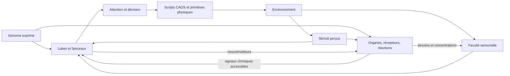
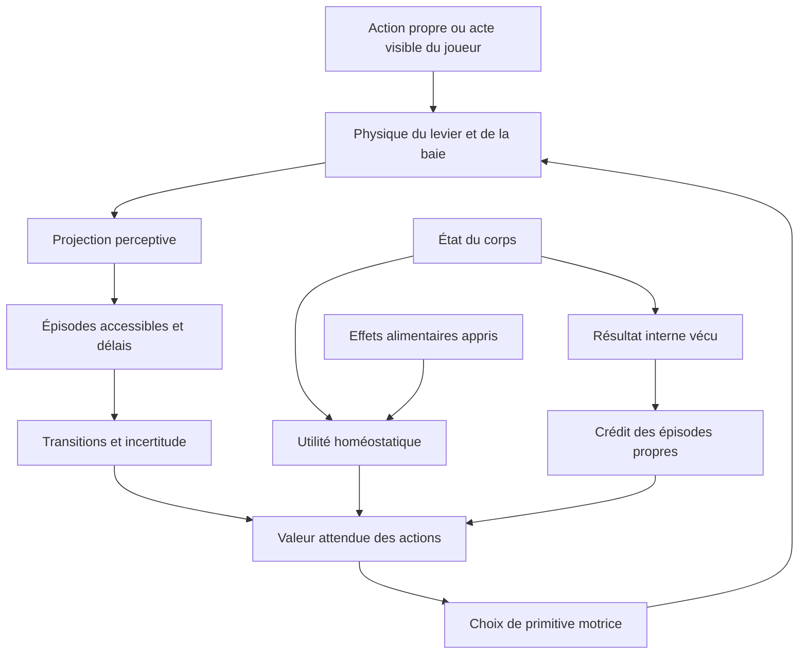

# Étude du moteur C3/DS et perspectives cognitives pour Luma

Date : **3 novembre 2026**. Mission documentaire : aucune modification du moteur, des interfaces, des tests ou des sauvegardes.

## 1. Résultats et périmètre

Le moteur étudié propose surtout un couplage entre **génome, réseau neuronal programmable, biochimie et actions physiques**. Il contient plusieurs formes de plasticité, des signaux de renforcement et des mécanismes d’attribution liés à l’attention. Il contient également des instincts génétiques et dépend de scripts d’action. Il ne faut donc pas le présenter comme un cerveau apprenant tous ses comportements sans prédispositions.

Luma possède déjà une base cohérente : simulation séparée du rendu, conséquences physiologiques effectives, associations initialement neutres, graines reproductibles et laboratoire individuel. Pour une distributrice, sa limite principale est l’absence de représentation d’une transition **action → événement extérieur → nourriture → effet biologique**.

La priorité proposée est une mémoire de transitions petite et inspectable, complétée par du crédit temporel. Porter le cerveau C3 entier serait beaucoup plus complexe et ne garantirait pas l’apprentissage causal recherché.

### Versions étudiées

| Dépôt | Commit figé | Périmètre |
| --- | --- | --- |
| `ugwun/creatures3-engine-port` | `915b7e82dcd7ec7bb1ca876fe380a0de8666f1aa` | Port C++ non officiel de C3/DS et outils contemporains |
| `Ankool29/Artificial-life` | `59e532fd10472bd65721b3b3f7aa7cf4023dcebb` | `main` après intégration du laboratoire de l’étape 3 |

Les liens de code sont épinglés à ces commits. L’étude est statique : aucun lancement ni compilation de C3, aucun actif commercial obtenu, aucune expérience biologique exécutée. Les tests Luma ont été lus ; ils n’ont pas été relancés pour cette modification documentaire.

### Niveaux de preuve

- **[C] Code** : structure ou chemin identifié par lecture ; cela ne signifie pas observation dans un jeu lancé.
- **[D] Documentation** : affirmation d’un guide, README ou catalogue ; configuration réelle non vérifiée ici.
- **[H] Hypothèse** : conséquence plausible à tester.
- **[P] Proposition** : architecture future pour Luma, absente du moteur actuel et non implémentée dans cette PR.

Le port contient des adaptations et des outils modernes. Cette étude ne certifie pas leur identité avec le moteur historique distribué commercialement.

## 2. Architecture effectivement présente dans C3/DS

### 2.1. Boucle biologique et facultés

**[C]** `Creature::Update` appelle les facultés sur une mise à jour interne sur quatre ticks d’agent, avec décalage propre à l’individu. Les neuf facultés sont créées dans cet ordre : sensorielle, cerveau, motrice, linguistique, biochimique, reproductive, expressive, musicale et vie. Ces calculs sont séquentiels ; perception, décision et biochimie ne changent pas toutes simultanément. La fréquence en secondes dépend de la boucle globale et de la vitesse du jeu. [C01] [C02]



Ce schéma représente des chemins de code, pas une preuve de raisonnement causal. Les comportements concrets des objets dépendent aussi des scripts et données du monde.

### 2.2. Neurones, lobes et faisceaux

**[C]** Un `Neuron` possède huit variables flottantes. Une `Dendrite` relie une source et une destination et possède huit variables de poids. Ce sont des états analogiques programmables, pas une simulation détaillée de potentiels d’action ni un réseau profond entraîné par rétropropagation. [C03] [C36] [C37]

`Brain::ReadFromGenome` lit les gènes de lobes et de faisceaux, charge les règles, trie les composants par `myUpdateAtTime`, leur fournit les concentrations chimiques et les initialise. Le génome définit ainsi une structure de traitement et ses programmes. Les plafonds de 255 lobes, 255 faisceaux et 65 025 neurones par lobe sont des limites techniques, pas les dimensions d’un cerveau standard. [C04] [C05]

Un lobe est une grille de neurones partageant des règles. Un faisceau relie des plages de neurones ; son câblage peut être régulier ou aléatoire, et parfois migrer. `Lobe::DoUpdate` applique les règles et gère le neurone sélectionné. La compétition de type gagnant unique repose sur une instruction SVRule ; le simple drapeau WTA lu dans le gène ne suffit pas à l’activer. [C06] [C07] [C08]

### 2.3. Lobes : fonctions démontrées et configuration inconnue

| Token | Fonction vérifiable dans le code | Réserve |
| --- | --- | --- |
| `driv` | Entrées alimentées par `GetDriveLevel` | La dynamique dépend des loci et du génome |
| `visn`, `elvn` | Déplacements horizontal et vertical des représentants visibles | Ce ne sont pas des images de pixels |
| `smel` | Signaux de champ chimique des pièces liés aux catégories | Perception symbolique et écologique |
| `situ`, `detl` | Situation corporelle et détails de la cible : âge, transport, proximité, taille, relations, etc. | Entrées construites explicitement par la faculté sensorielle |
| `noun`, `verb` | Catégories et actions stimulables par stimuli/langage | Une dérogation motrice peut aussi être imposée |
| `attn`, `decn` | Attention et décision lues par la faculté motrice | Les actions exécutables restent des routines |
| `resp`, `prox` | Ajustements de besoins routés différemment selon l’éveil | Une modification chimique ne provoque pas toujours un entraînement |
| `forf`, `comb` | États modifiés dans des chemins sensoriels sociaux | Fonction complète dépendant des règles génétiques |
| `stim`, `mood`, tailles et disposition « standard » | Décrits dans les guides du port | **[D]** configuration complète non reproduite ici |

Les huit premières lignes sont **[C]** : perception [C09], moteur [C10], stimuli [C11], reconnaissance sociale [C12].

**[D]** Le guide `brain_deep_dive.md` rapporte un cerveau de 15 lobes, dont un `comb` de 440 neurones. Ce relevé annoncé par ses auteurs n’a pas été reproduit. `Brain.catalogue` énumère douze noms et emploie notamment `sitn`, tandis que le code sensoriel adresse `situ` et `elvn`. Un catalogue descriptif n’est pas le génome exprimé : ces différences interdisent de déduire une topologie canonique, sans prouver à elles seules un défaut d’exécution. [D01] [C13]

### 2.4. SVRules

**[C]** Une SVRule contient seize instructions. `SVRule::ProcessGivenVariables` accède aux états neuronaux, variables dendritiques, neurone de référence, aléatoire et concentrations chimiques, y compris indexées par identifiants neuronaux. Les opérations comprennent arithmétique, conditions, persistance, bornage, compétition et configuration du renforcement. Les sauts restent dans un programme court. [C07]

La capacité d’une instruction ne prouve pas son emploi par chaque génome. Une variable de travail peut conserver un état temporel ; on ne peut pas la qualifier systématiquement de trace d’éligibilité sans décoder les règles concernées.

### 2.5. Biochimie, organes, besoins et hormones

**[C]** La biochimie contient 256 concentrations bornées entre 0 et 1, avec l’indice 0 conventionnellement réservé à l’absence de substance. Les gènes décrivent demi-vies, injections, récepteurs, émetteurs, réactions et neuroémetteurs. Certaines constantes identifient ATP, ADP, glycogène ou progestérone ; la signification de nombreux indices dépend des données. Rien ne permet de nommer tous les signaux de renforcement « dopamine ». [C14] [C15]

`Organ::Update` gère horloge, énergie, atteintes et forces vitales. `ProcessReaction` prélève les réactifs selon leurs proportions et le réactif limitant, puis ajoute les produits avec une cinétique calculée. `ConsumeEnergy` consomme de l’ATP et produit de l’ADP ; un manque énergétique peut endommager l’organe. [C16] [C17]

Les concentrations sont partagées entre organes et les mises à jour séquentielles. Ce n’est ni une simulation volumétrique des transports entre compartiments ni une garantie générale de conservation physicochimique.

Les récepteurs convertissent une concentration en valeur de locus par seuil, gain, valeur nominale et réponse analogique ou discrète ; les émetteurs assurent le chemin inverse. Des loci portent les besoins, transmis au lobe `driv`. `Brain::GetLocusAddress` expose aussi des états neuronaux adressables : quatre premiers états par neurone dans ce chemin, malgré huit variables internes. Les neuroémetteurs utilisent un produit d’activations pour émettre des substances à une cadence génétique. [C17] [C18] [C19] [C09]

**Principe transférable :** rendre explicites les boucles entre état corporel, besoin, décision et plasticité. Leur cohérence et leurs constantes de temps comptent davantage que le nombre de substances.

### 2.6. Génétique, expression et diversité

**[C]** Les gènes sont typés et portent notamment identifiant, génération, âge d’expression, indicateurs, mutabilité et variante. `GetGeneType` et `TimeToSwitchOn` filtrent âge, sexe, inhibition et variante. Les types couvrent lobes, faisceaux, organes, biochimie, stimuli, instincts, apparence, poses et allures. [C20] [C38]

`Genome::Cross`, `CrossLoop`, `CopyGene` et `CopyCodon` réalisent croisement et mutations ; duplication et suppression dépendent des indicateurs. `GenomeStore::CrossoverFrom` et `CloneSlot` participent à la gestion des descendants et clones. La structure exprimée peut donc varier, au-delà de coefficients sur une architecture fixe. [C21] [C39]

`Instinct::Process` injecte des entrées suggérées, tente d’obtenir une décision et stimule une réponse de renforcement. Le cerveau traite ces prédispositions dans un mode lié au sommeil/rêve, signalé par des substances paramétrées. L’apprentissage C3 ne part donc pas nécessairement sans associations innées. [C22] [C23] [C05]

**[P]** Pour Luma, conserver besoins innés et primitives motrices générales ; éviter des instincts « telle catégorie d’objet → telle action » qui prédétermineraient la préférence recherchée.

### 2.7. Perception et exécution autonome

**[C]** La faculté sensorielle choisit des représentants par catégorie selon des stratégies de catalogue : proximité, hasard, même pièce, etc. Elle transmet positions et détails, plutôt qu’un état exhaustif du monde. [C09] [C12]

`MotorFaculty::Update` lit attention et décision, résout la cible `IT`, applique éventuelles dérogations et contraintes d’éveil, puis sélectionne des scripts CAOS avec des replis d’événements. Il existe aussi des actions involontaires. Une décision apprise peut ainsi déclencher une primitive programmée : le caractère émergent ne signifie pas absence de routines physiques. [C10] [C24]

## 3. Plasticité et attribution du crédit dans C3

### 3.1. Renforcement réellement codé

**[C]** `Tract::ProcessRewardAndPunishment` exige un renforcement activé et une sortie destination non nulle. Il ne compare pas explicitement l’identité du neurone à un gagnant : « seul le gagnant apprend » dépend des règles de sortie du lobe. [C25]

`ReinforceAVariable` modifie le poids court terme lorsque la concentration dépasse le seuil :

```text
poids' = borne[-1,1](poids + taux × (concentration − seuil))
```

Récompense et punition utilisent la même opération ; le signe dépend du taux configuré. Les gestionnaires `HandleSetReward*` et `HandleSetPunishment*` fixent seuils, taux et substances. Ce chemin n’est pas une règle universelle de Q-learning ou de rétropropagation. [C25] [C26]

### 3.2. Court terme, long terme et structure

**[C]** `HandleSetLTtoSTRateAndDoCalc` calcule, à partir des anciennes valeurs :

```text
court' = court + a × (long − court)
long'  = long  + b × (court − long)
```

Le champ nommé `STtoLTRate` fournit ici `a` ; l’opérande de l’autre instruction fournit `b`. Les noms seuls peuvent induire en erreur. Des taux appropriés peuvent permettre adaptation rapide, rappel vers une mémoire stable et consolidation ; l’usage effectif dépend des SVRules du génome. Les raccourcis des guides ne remplacent pas ces affectations. [C26] [D01] [D02]

Certains faisceaux recensent les dendrites faibles, sélectionnent des neurones selon un état de croissance/migration, déplacent les connexions et les réinitialisent. Cette plasticité structurelle est optionnelle ; elle change le câblage. Les paramètres de catalogue incluent une limite de migrations et un indice de force. [C27] [C08] [C13]

### 3.3. Stimuli, attention et filtre synchrone

**[C]** `Stimulus::Process` distribue les stimuli par destinataire explicite, audition, vision ou contact. `SensoryFaculty::Stimulate` distingue modification chimique et entraînement ; des indicateurs peuvent désactiver ce dernier. La commande CAOS `STIM` renseigne source et événement du script. [C28] [C11] [C40]

`AdjustChemicalLevelWithTraining` modifie d’abord la chimie. Pour un signal de besoin reconnu et une source valide, il transmet éventuellement un ajustement à `resp` si la créature est alerte, sinon à `prox`. Lorsque `engine_synchronous_learning == 1`, certaines sources doivent en plus correspondre à la décision courante, au script attendu et à la cible d’attention. La créature elle-même et le pointeur ont un traitement particulier. [C11] [C24]

Il s’agit d’un **filtre d’attribution**, pas d’une preuve de causalité contrefactuelle ni d’un algorithme général de chaînes différées. Son activation dans un monde commercial donné n’a pas été vérifiée.

### 3.4. Observation d’autrui

**[C]** Réception de stimuli, langage et reconnaissance sociale sont présents. `LinguisticFaculty` utilise notamment `Brain::GetKnowledge` pour produire des suggestions à une autre créature. [C28] [C29]

**Non établi :** qu’observer le joueur presser un levier suffise à apprendre spontanément la chaîne complète. Stimulus visible, conseil verbal et apprentissage de sa propre action sont distincts. Aucun raisonneur causal général par observation n’a été identifié dans les chemins étudiés ; ce constat ciblé ne prouve pas son impossibilité dans toutes les combinaisons de scripts et génomes.

## 4. Visualisation et débogage biologique

**[C]** `DebugServer.cpp` expose observations, chimie, organes, interventions, génome, lobes, neurones et faisceaux. Le port ajoute des interfaces navigateur/MCP autour de ces capacités ; les fonctions historiques de dump neuronal ne doivent pas être confondues avec toute cette interface récente. [C30] [C31] [C32] [C05]

La chronologie `ethology_timeline.js` conserve sources et intervalles d’observation. Son guide distingue observé, dérivé, inféré et inconnu, et rappelle qu’une succession temporelle ne prouve pas une cause. Un inspecteur Luma devrait respecter cette distinction. [C33] [D03]

**Piège vérifié :** le champ historique d’API `health` est explicitement le glycogène, pas une santé agrégée. Son nom serait trompeur si on le comparait directement à la santé de Luma. [C34]

**[P]** Pour Luma, un diagnostic facultatif pourrait afficher besoins et scores candidats, effets attendus, résultat vécu, erreur de prédiction, acteur observé, trace créditée et incertitude. Les causes réelles réservées au diagnostic ne doivent pas être transmises au cerveau.

## 5. Comparaison avec Luma

Les constats Luma sont **[C]** sur le commit figé, et les limites C3 conservent les réserves précédentes.

| Dimension | C3/DS étudié | Luma actuel | Implication |
| --- | --- | --- | --- |
| Génétique | Gènes typés, développement, structure et règles | Treize loci scalaires exprimés, structure fixe | Garder l’interprétabilité avant d’ajouter des modules |
| Métabolisme | Réactions, organes, ATP/ADP, demi-vies, récepteurs | Digestion différée, énergie, toxines, santé, élimination | Ajouter quelques dynamiques couplées si utiles |
| Besoins | Loci chimiques transmis aux lobes | Faim dérivée, stimulation, fatigue, stress | Unifier progressivement l’utilité homéostatique |
| Mémoire alimentaire | Dépend des génomes et règles neuronales | Une valeur par signal, apprise après digestion | État du corps et effets attendus encore confondus dans une valeur |
| Mémoire des objets | Réseaux action/attention, réponses et physique scriptée | Valeur et vecteur de changements internes par catégorie | Bonne base pour effets directs, insuffisante pour ressources extérieures |
| Plasticité | Renforcement, signaux chimiques, court/long terme, migration | Taux génétique fixe de règle delta | Modulation et deux temps possibles sans réseau complet |
| Décision | Sorties attention/action et routines CAOS | Scores explicites, faim urgente, repos, exploration et apaisement | Ajouter des candidats action–objet avec transitions |
| Perception | Catégories représentées, détails, odeurs, social | Rayon, positions, distances et signaux ; composition cachée | Ajouter changements observables et suivi d’identité |
| Crédit | Portes chimiques, activité et synchronisation optionnelle | Effets cumulés attribués directement au signal du bolus/objet | Référence directe utile, sans inférence des causes intermédiaires |
| Diversité | Structure, développement, croisement et histoire | Paramètres physiologiques, héritage asexué, états et histoires propres | Le laboratoire suffit pour expérimenter sans cohabitation |
| Émergence | Assemblage de génome, chimie, instincts et scripts | Trajectoires variables dans un répertoire et une utilité prévus | Distinguer variation d’usage et acquisition d’une compétence |
| Reproductibilité | Aléatoire et cadence identifiés, déterminisme complet non audité | RNG et état explicites, graines et essais à ticks égaux | Préserver cet avantage |
| Diagnostic | Outils riches du port, API historiques | Panneau facultatif, associations, journal borné et laboratoire | Expliquer décisions et conséquences différées |

Sources Luma : [L01] [L02] [L03] [L04] [L05] [L06] [L07] [L08] [L09] [L10] [L11].

### 5.1. Audit des treize paramètres exprimés

Aucun locus ne désigne une catégorie de baie ou d’objet. Les sept nouveaux paramètres physiologiques valent 1 pour les anciens génomes v1. [L01]

| Locus | Effet calculé | Conséquence comportementale possible |
| --- | --- | --- |
| `speed` | Déplacement par tick et coût moteur ajusté en v2 | Temps et énergie pour atteindre une cible |
| `vision` | Rayon et normalisation de la pénalité de distance | Candidats perçus et coût apparent |
| `efficiency` | Énergie assimilée des nutriments | Bilan alimentaire et faim future |
| `detox` | Élimination des toxines | Retour aux conditions permettant la régénération |
| `learningRate` | Taux des mises à jour alimentaires et objets | Poids des expériences récentes |
| `exploration` | Probabilité d’essai alimentaire exploratoire | Réessai possible après une association négative |
| `metabolicRate` | Dépense énergétique basale et motrice | Rythme d’apparition de la faim |
| `digestionRate` | Débit d’absorption partagé | Délais d’assimilation et de renforcement |
| `toxinSensitivity` | Dommage à l’absorption | Conséquences apprises des aliments toxiques |
| `stimulusGain` | Gain des effets sur la stimulation | Effets vécus et mémorisés des objets |
| `stressSensitivity` | Gain des effets sur le stress | Apaisement recherché et bilan des interactions |
| `recoveryRate` | Récupération de fatigue/stress pendant le repos | Arbitrage entre repos et autres actions |
| `stimulationDecay` | Perte de stimulation | Évolution du besoin d’explorer |

Points d’application : métabolisme [L02], besoins/objets [L03], choix [L05], perception [L06], déplacement [L07]. Ils attestent l’expression des paramètres, pas une mesure de leur ampleur dans toutes les situations. `exploration` est alimentaire et ne représente pas tout le mécanisme de curiosité.

### 5.2. Forces à conserver

1. **Conséquences réelles dans le modèle.** Assimilation, sensibilité aux toxines et gains de réaction modifient les bilans appris, sans préférence génétique par signal.
2. **Neutralité et séparation des histoires.** Les mémoires commencent neutres ; les tests comparent physiologies et expériences individuelles. Ce sont des garanties ciblées, pas une validation de toute forme d’émergence.
3. **Simulation indépendante du rendu.** Pas fixe, sauvegardes versionnées et essais conservant les originaux.
4. **Coût borné.** Un individu actif ; plafonds de 48 aliments et 12 objets. Les profils inactifs ne sont pas simulés ; l’interface vise 30 images/s et 4 mises à jour DOM/s. [L07] [L08] [L09] [L10]

### 5.3. Limites et incohérences potentielles

| Constat | Portée et expérience utile |
| --- | --- |
| **[C] Pas de transitions extérieures** : les mémoires concernent les effets corporels d’une catégorie | Un nouvel objet ne suffit pas à apprendre « presser pour faire apparaître » |
| **[C] Valeur alimentaire scalaire** : épisodes vécus à différents états mélangés ; énergie assimilable plafonnée | Comparer jeûne/satiété ; envisager des effets attendus séparés |
| **[C] Généralisation par signal** | Deux machines semblables partagent la mémoire, sauf contexte/identité perceptible ajouté |
| **[C] Vecteur d’effets et valeur scalaire d’objet partiellement redondants** | Ablater chaque terme ; ce doublon n’est pas une erreur démontrée |
| **[C] Poids de récompense et arbitrages choisis dans le code** | Mécanismes généraux admissibles, mais politique non entièrement apprise |
| **[C] Crédit direct privilégié** : le moteur connaît les effets propres au bolus/objet | N’atteste pas une inférence de leur origine par la créature |
| **[C] Stock de toxines sans dommage secondaire continu** | Le dommage survient à l’absorption ; le stock retarde surtout la régénération. `detox` reste actif |
| **[C] Génétique fixe sans développement** | Pas de nouvelles enzymes ou règles par âge ; limite raisonnable au stade actuel |
| **[C] Mutation et bornage distincts** | Un import v1 extrême peut être accepté hors des intervalles de naissance v2 ; le descendant est borné, donc le changement total peut dépasser la petite mutation. Les v1 ordinaires générés sont compatibles |
| **[H] Cycles de régulation survalorisés** | Mesurer bénéfice net, dérives pendant l’action et bornes. Une répétition apaisante peut aussi être cohérente |
| **[C]/[H] Nouveauté différente d’incertitude** | Le nombre d’interactions ne mesure pas l’incertitude après panne ou réparation |
| **[C]/[H] RNG partagé dans un monde** | Des décisions différentes consomment des tirages différents. Pas de panne aléatoire actuelle ; séparer les flux avant d’en ajouter |

Sources : [L01] [L02] [L03] [L04] [L05] [L06] [L07] [L08] [L09]. Aucune correction n’est incluse ici.

## 6. Plasticité : signification précise

### Luma

**[C]** `learningRate` est un coefficient génétique fixe :

```text
estimation' = estimation + plasticité × (bilan − estimation)
```

Avec une plasticité de 0,30, une estimation de 0,20 et un bilan de 1 donnent 0,44. Le même taux actualise les quatre composantes d’effets attendus d’un objet. L’unité est l’expérience traitée, pas la seconde : une digestion plus lente modifie aussi le nombre d’apprentissages alimentaires par minute. [L04] [L03]

Une plasticité élevée favorise les résultats récents ; une faible plasticité adapte plus lentement. Ce paramètre ne mesure ni intelligence générale, ni capacité de mémoire, ni compréhension automatique d’une nouvelle action.

### C3/DS

**[C]** Aucun curseur unique équivalent n’est identifié : règles génétiques, activité des destinations, concentrations, seuils, taux, poids court/long terme et migration interviennent. Persistance d’activation et changement synaptique sont également distincts. [C07] [C25] [C26] [C27]

**[P]** Conserver le taux génétique de Luma, puis tester séparément modulation bornée, mémoire rapide/lente et incertitude. Leur utilité doit apparaître dans des expériences de stabilité, changement de contingence et réacquisition.

## 7. Future distributrice : architecture proposée

**Toute cette section est [P] ; aucune fonctionnalité n’est implémentée.**

### 7.1. Quatre problèmes à distinguer

| Question | Représentation nécessaire | Raccourci à éviter |
| --- | --- | --- |
| Mon action change-t-elle quelque chose ? | Commande propre, contact/mouvement perçu, contexte | Animation sans conséquence |
| Ce mouvement rend-il une baie disponible ? | Transition extérieure, délai, accessibilité | Hausse de satiété lors de la pression |
| Cette baie est-elle bénéfique ? | Ingestion et effets biologiques propres | Étiquette « bonne baie » connue d’avance |
| Le mécanisme fonctionne-t-il encore ? | Attente, absence suffisamment observée, incertitude | Lecture d’un indicateur caché de panne |

La physique peut programmer qu’une pression valide produit une baie si le mécanisme fonctionne. Le cerveau doit apprendre la relation, sans récompense spéciale « machine ».

### 7.2. Vérité physique et perception séparées

Prévoir deux flux :

- **Journal de vérité**, réservé aux diagnostics et tests : auteurs réels, origine des ressources, identifiants causaux, stock et panne.
- **Expérience accessible** : mouvement visible, bruit audible, apparition visible d’une baie, contact, position, interoception et éventuelles interruptions perceptives.

Un identifiant de suivi peut aider à reconnaître un objet perçu. Il ne doit pas révéler sa fonction ou l’origine cachée d’une baie. Voir une baie sortir d’un conduit est une observation ; recevoir systématiquement le `sourceMachineId` interne serait une connaissance supplémentaire.



Des primitives générales regarder, approcher, toucher ou presser sont acceptables. Une règle « faim → presser cette machine » ne l’est pas pour l’objectif retenu.

### 7.3. Mémoire factorisée

Un épisode pourrait conserver tick, contexte perceptible, objet suivi, acte, auteur perçu, résultat, délai, qualité d’observation et état interne.

Trois modèles séparés :

1. **Action → événement** : ma tentative produit-elle un mouvement ?
2. **Événement → ressource** : ce mouvement est-il suivi d’une baie accessible ?
3. **Ressource → effet interne** : cette nourriture est-elle utile à ma physiologie ?

La panne modifie la deuxième relation sans effacer la préférence alimentaire. Une baie devenue nocive modifie l’utilité de l’issue sans exiger une règle « toutes les machines sont mauvaises ».

Une petite table bornée de transitions et délais suffit pour commencer. Un réseau n’est nécessaire que si une limite de généralisation est démontrée.

### 7.4. Attribution du crédit

Le bénéfice arrive après pression, apparition, approche, ingestion et digestion. Deux mécanismes complémentaires :

- **Modèle des transitions** : réévaluer une ancienne action quand l’issue alimentaire est mieux connue. Une relation durable n’est pas limitée à une trace de quelques secondes.
- **Critique temporel avec éligibilité** : attribuer une erreur de prédiction aux actions propres encore éligibles. Les différences temporelles fournissent un cadre méthodologique ; ce n’est pas une description du code C3. [R01]

Formulation candidate, à préciser avant implémentation :

```text
erreur = résultat_biologique + γ(Δt) × V(état_suivant) − Q(état, action)
trace  = décroissance(Δt) × trace + activité_de_l'action_propre
Q      = Q + taux_effectif × erreur × trace
```

Politique, durée variable des transitions, interruption, bornes et convention des traces doivent être explicites. Les horloges sont celles de la simulation : pause, onglet masqué ou profil inactif ne constituent pas des preuves supplémentaires de panne.

L’apparition d’une baie apporte une valeur prédite, pas une seconde récompense alimentaire indépendante. Compter apparition et digestion comme deux bénéfices créerait une surévaluation. Une utilité homéostatique doit aussi intégrer les coûts nets de temps et d’énergie, et être comparée aux bilans directs actuels.

### 7.5. Apprentissage par observation

Observer peut mettre à jour « après ce mouvement, une baie apparaît ». Cela ne nourrit pas l’observateur et ne prouve pas qu’il peut lui-même produire le mouvement.

Les travaux sur l’apprentissage à partir d’observations distinguent justement états observés et actions capables de les produire. La notice de Torabi, Warnell et Stone sert ici de repère, sans reproduction de leur système. [R02]

Séquence proposée :

1. Si joueur, levier et issue sont visibles, accumuler une hypothèse avec incertitude.
2. Si seule la baie est visible après une occlusion, ne pas reconstruire une démonstration complète depuis le journal interne.
3. Établir ensuite si une primitive propre peut produire le même changement, par expérience motrice.
4. Mettre à jour la valeur personnelle avec les conséquences biologiques effectivement vécues.

Pas de macro préchargée « reproduire le distributeur », pas de crédit d’action propre pour un acte uniquement observé, pas d’équivalence automatique entre capacités du joueur et de la créature.

### 7.6. Panne, extinction, réparation

Une absence n’est informative que si la fenêtre attendue a été suffisamment observée. Occlusion, interruption ou manque de données ne prouvent pas une panne.

Des essais sans issue diminuent l’attente de production et/ou donnent une erreur négative. L’intérêt de la baie reste intact. Incertitude et changements contextuels peuvent justifier un nouvel essai après réparation. Une éventuelle « déception » devrait être un mécanisme général de surprise, sans sanction spéciale de cet objet.

Comparer `P(baie | mouvement)` à `P(baie | absence de mouvement)` donne un indice de contingence, pas une preuve causale suffisante. Une cause concurrente ou la sélection des moments d’action peuvent expliquer la corrélation. Il faut des interventions et contrôles.

### 7.7. Expériences discriminantes

| Expérience | Résultat attendu | Raccourci détecté |
| --- | --- | --- |
| Permuter apparence et position après apprentissage | L’histoire et le contexte expliquent l’évolution | Préférence codée par couleur/position |
| Baies aussi fréquentes mais indépendantes des pressions | Relation instrumentale plus faible | Corrélation temporelle prise pour causalité |
| Joueur avec issue, sans issue, puis issue seule | Transitions et exposition distinguées | Transfert direct de récompense |
| Démonstration hors perception | Pas d’apprentissage équivalent | Fuite du journal de vérité |
| Levier utilisable uniquement par le joueur | Issue connue, contrôlabilité propre non acquise | Capacité supposée identique |
| Même baie, physiologies différentes | Utilités différentes après expérience | Récompense fixe « machine » |
| Même génome, histoires différentes | Attentes différentes | Personnalité prédéfinie |
| Délais variables avec action distractrice | Crédit supérieur à « dernier objet touché » | Trace trop courte ou mauvaise attribution |
| Panne puis réparation | Extinction et réacquisition graduelles | Mémoire rigide ou état caché connu |
| Deux machines dont une défaillante | Discrimination si identité/contexte perceptible | Valeur uniquement globale |
| Baie devenue toxique, machine fonctionnelle | Réévaluation selon effets alimentaires | Association « machine toujours bonne » |
| Sauvegarde pendant le délai et changement de profil | Reprise équivalente aux mêmes ticks | Horloge murale ou traces non sauvegardées |

Mesurer réussite propre, tentatives, nourriture obtenue, coût énergétique, délais d’extinction/réacquisition, calibration et erreurs d’attribution. Employer plusieurs graines, contrôles appariés et incertitude statistique ; fixer les seuils avant sélection des trajectoires. Une vidéo réussie ne suffit pas.

## 8. Feuille de route progressive

Les coûts Android sont des estimations à mesurer, pas des benchmarks. Un seul individu reste actif.

| Étape | Intérêt émergent | Complexité | Coût Android envisagé | Compatibilité et expérience de validation |
| --- | --- | --- | --- | --- |
| **0. Instrumentation** | Hypothèses de décision réfutables | Faible à moyenne | Faible, journal circulaire | Politique inchangée ; replays et explication des valeurs |
| **1. Actions et événements perçus** | Expériences sur effets extérieurs | Moyenne | Faible, événements bornés | Primitives sans préférences ; contact, auteur, occlusion |
| **2. Transitions et absences** | Relations action–ressource et pannes | Moyenne | Faible à modéré, table sparse | Mémoire séparée ; nourriture non contingente et panne/réparation |
| **3. Crédit temporel et valeur indirecte** | Actions utiles malgré délai biologique | Moyenne à élevée | Modéré, traces bornées | Comparaison avec politique actuelle ; délais et distracteurs sans double récompense |
| **4. Observation** | Découverte avant exécution propre | Élevée | Faible à modéré en symbolique | Séparer acteur/capacité ; visible/masqué et levier réservé |
| **5. Plasticité modulée et rapide/lente** | Flexibilité et stabilité | Moyenne | Faible, quelques variables | Taux génétique conservé ; extinction, réacquisition, oubli |
| **6. Biochimie minimale plus couplée** | Appétits sensibles aux réserves/coûts | Moyenne à élevée | Modéré pour quelques réactions | Un sous-système à la fois ; cinétique, bornes, héritabilité |
| **7. Réseau parcimonieux si nécessaire** | Généralisation contextuelle | Élevée | Variable, potentiellement élevé | Seulement après limite démontrée de la table, à budget comparable |

### Contraintes proposées

- **Modules séparés** : physique, perception, épisodes, transitions, effets alimentaires, critique, décision et diagnostic.
- **Budget borné** : quelques dizaines d’épisodes et, comme hypothèse initiale, une centaine de relations actives ; mesurer avant d’augmenter. Éviter le produit combinatoire de tous les états et objets.
- **Temps et hasard** : ticks simulés ; flux distincts pour génétique, exploration et événements du monde. Préserver le chemin historique tant que l’extension expérimentale n’est pas activée.
- **Sauvegardes** : versionner croyances, traces, suivi perceptif et RNG ; conserver les associations alimentaires. Vérifier les plafonds actuels de 100 000 caractères par monde et 1,5 million pour l’archive du laboratoire. [L09] [L08]
- **Compatibilité** : migration explicite, valeurs neutres pour nouveaux champs, replays d’anciennes sauvegardes, un seul profil avancé.
- **Performance** : mises à jour sur événements, structures bornées, diagnostic à la demande ; mesures sur S25 Ultra et un Android moins puissant.

Recommandation : réaliser les étapes 0 à 3, puis mesurer. Ni une biochimie de 256 substances ni un grand réseau ne doivent précéder la démonstration d’un apprentissage instrumental simple.

## 9. Licences, provenance et réutilisation

| Élément vérifié | Constat au commit étudié | Conséquence |
| --- | --- | --- |
| Port C3/DS | Aucun fichier global `LICENSE`, `LICENCE`, `COPYING`, `NOTICE` ou équivalent identifié parmi les fichiers suivis ; métadonnée GitHub `license: null` | Aucune autorisation globale de reprise établie |
| Sources et outils/MCP | Mentions d’auteurs/dates, sans concession globale repérée dans les fichiers centraux et manifestes examinés | Public et modifiable ne signifie pas librement réutilisable |
| Données commerciales | README : non incluses ; copie légitime de Creatures Exodus requise | Ne pas reprendre sprites, sons, génomes commerciaux ou scripts de contenu |
| Dépendances | CMake : SDL2, SDL2_mixer, zlib, GoogleTest ; licences individuelles dans le lockfile MCP | Licences propres aux dépendances, sans extension automatique au moteur |
| PDF du port | Titre interne d’analyse moderne ; provenance officielle et licence non établies | Source secondaire, non reproduite |
| Luma | Aucun fichier de licence explicite identifié au commit figé | Choix de licence à effectuer par le propriétaire ; aucune licence ajoutée ici |

Les contrôles portent sur les noms des fichiers suivis, mentions des sources/manifestes pertinents, métadonnées et README. Ils ne reconstituent pas toute la chaîne de droits historique et ne prouvent pas l’absence d’accord externe. Les EULA commerciales n’ont pas été auditées. Versions et notices de dépendances doivent être vérifiées si elles sont intégrées ultérieurement. [D04] [C35]

La documentation GitHub distingue les possibilités d’accès/fork d’un dépôt public d’une licence autorisant la réutilisation du code. La publication ne remplace pas une concession de droits. Cela ne règle pas les éventuels contrats historiques de C3. [R03]

**Conséquence pratique :** aucune reprise de code, actif, génome ou texte substantiel du port dans Luma. Ce rapport reformule les mécanismes et propose une architecture propre. Une reprise future exige clarification des droits et une licence explicite des titulaires concernés. Les principes généraux peuvent guider une conception indépendante ; ce n’est pas une autorisation de copier leur expression. La licence d’un autre moteur, notamment OpenC2E, ne s’applique pas automatiquement à ce dépôt.

## 10. Limites et points restant à vérifier

1. **Pas d’exécution C3** : génome commercial exprimé, mode synchrone réellement activé, signaux et machine en fonctionnement non observés.
2. **Port distinct du binaire historique** : adaptations et outils récents, sans audit exhaustif de leurs différences.
3. **Guides secondaires** : tailles des lobes et exemples appris non reproduits. Le PDF nommé documentation technique possède un titre interne d’analyse moderne ; il n’est pas traité comme manuel officiel de l’éditeur. [D01] [D02] [D05]
4. **Crédit neural incomplet** : règles génériques connues, algorithme complet d’un cerveau donné dépendant de son génome. Aucun TD(λ) ou raisonneur causal universel attribué à C3 sans preuve.
5. **Déterminisme C3 non certifié** : hasard et cadencement identifiés, sérialisation complète du RNG et reproductibilité inter-plateformes non auditées.
6. **Luma statique** : tests lus, sans nouvelle campagne d’exécution ni benchmark Android.
7. **Propositions non validées** : identifiabilité causale, observation, absence et extinction restent à démontrer expérimentalement.
8. **Licences non clarifiées** : provenance et droits historiques non résolus par l’absence de licence trouvée.

Une prochaine expérience C3 devrait utiliser des données légitimes dans un monde isolé et enregistrer génome exprimé, SVRules, chimie, attention, décisions, scripts et ticks. Une prochaine PR Luma devrait commencer par instrumentation et contrôles, avec le moteur existant comme référence.

## 11. Index des sources et fonctions

Les liens C et L pointent au code figé ; D à la documentation du port. Le point d’entrée est lié, les autres fonctions sont nommées pour suivre les appels.

| Référence | Fichier et fonctions étudiés |
| --- | --- |
| [C01] | `Creature.cpp` : `Update`, `GetDriveLevel` |
| [C02] | `Creature.cpp` : création et ordre des facultés |
| [C03] | `BrainConstants.h` : dimensions et limites |
| [C04] | `Brain.cpp` : `ReadFromGenome` |
| [C05] | `Brain.cpp` : `RegisterBiochemistry`, `SetWhetherToProcessInstincts`, `UpdateComponents`, `Update` |
| [C06] | `Lobe.cpp` : génome, `Initialise`, `DoUpdate` |
| [C07] | `SVRule.h` : variables, instructions, `ProcessGivenVariables` |
| [C08] | `Tract.cpp` : construction, `DoUpdate`, `ClearActivity` |
| [C09] | `SensoryFaculty.cpp` : `Update`, représentants, `SetVisualInput` |
| [C10] | `MotorFaculty.cpp` : `Update` |
| [C11] | `SensoryFaculty.cpp` : `Stimulate`, `ReadFromGenome`, `AdjustChemicalLevelWithTraining` |
| [C12] | `SensoryFaculty.cpp` : chemins sociaux `forf`/`comb` |
| [C13] | `Brain.catalogue` : noms, besoins, paramètres de migration et instincts |
| [C14] | `BiochemistryConstants.h` : substances et loci |
| [C15] | `Biochemistry.cpp` : `ReadFromGenome` |
| [C16] | `Organ.cpp` : `Update`, énergie, horloges et vie |
| [C17] | `Organ.cpp` : `ProcessReceptors`, `ProcessReaction`, `ConsumeEnergy` |
| [C18] | `Brain.cpp` : `GetLocusAddress` |
| [C19] | `Biochemistry.cpp` : `Update`, neuroémetteurs |
| [C20] | `Genome.cpp` : `GetGeneType`, `TimeToSwitchOn` |
| [C21] | `Genome.cpp` : `Cross`, `CrossLoop`, `CopyGene`, `CopyCodon` |
| [C22] | `Instinct.cpp` : constructeur et `Process` |
| [C23] | `LifeFaculty.cpp` : `SetState` |
| [C24] | `BrainScriptFunctions.cpp` : correspondances décision/script |
| [C25] | `Tract.cpp` : `ProcessRewardAndPunishment`, `ReinforceAVariable` |
| [C26] | `SVRule.cpp` : configuration du renforcement et calcul court/long terme |
| [C27] | `Tract.cpp` : `UpdateWeakDendritesList`, `MigrateWeakDendrites`, `AttemptMigration` |
| [C28] | `Stimulus.cpp` : `InitFromGenome`, `Process` |
| [C29] | `LinguisticFaculty.cpp` : conseils et `Brain::GetKnowledge` |
| [C30] | `DebugServer.cpp` : observation |
| [C31] | `DebugServer.cpp` : chimie, interventions et organes |
| [C32] | `DebugServer.cpp` : cerveau, lobes, neurones et faisceaux |
| [C33] | `tools/ethology_timeline.js` : observations, sources et chronologie |
| [C34] | `DebugServer.cpp` : sens du champ `health` |
| [C35] | `CMakeLists.txt` : dépendances ; manifestes MCP également examinés |
| [C36] | `Brain/Neuron.h` : structure et états |
| [C37] | `Brain/Dendrite.h` : extrémités et poids |
| [C38] | `Genome.h` : en-têtes, types et indicateurs |
| [C39] | `GenomeStore.cpp` : `CloneSlot`, `CrossoverFrom` |
| [C40] | `Caos/CreatureHandlers.cpp` : `Command_STIM` et provenance |
| [L01] | `genome.ts` : `physiology`, `generateGenome`, `inheritGenome`, intervalles et anciens génomes |
| [L02] | `metabolism.ts` : `hunger`, `ingest`, `metabolize` |
| [L03] | `curiosity.ts` : `motivations`, `updateNeeds`, `applyObjectEffects`, `learnInteraction` |
| [L04] | `brain.ts` : `createBrain`, `reinforce` |
| [L05] | `decisions.ts` : `decideFood`, `decide` |
| [L06] | `perception.ts` : `perceive`, `perceiveObjects` |
| [L07] | `world.ts` : initialisation, `addFood`, `step`, journal et actions |
| [L08] | `lab/laboratory.ts` : profils, terrains, essais, avance du profil actif |
| [L09] | `persistence.ts` : `serialize`, `deserialize`, validation |
| [L10] | `main.ts` : horloge, panneau, commandes et stockage |
| [L11] | `tests/laboratory.test.ts` : diversité, physiologie, reproductibilité, compatibilité ; tests des étapes 1/2 également lus |
| [D01] | `brain_deep_dive.md` : guide secondaire |
| [D02] | `drives_and_learning.md` : guide secondaire |
| [D03] | `ethology_timeline.md` : guide de chronologie |
| [D04] | README : données commerciales et fonctionnement du port |
| [D05] | PDF du port : analyse secondaire, provenance officielle non établie |

### Références méthodologiques et juridiques

- **[R01]** R. S. Sutton, *Learning to predict by the methods of temporal differences*, 1988, DOI `10.1007/BF00115009`. Notice et résumé de l’éditeur consultés ; texte intégral non relu. Référence de méthode, pas preuve sur C3.
- **[R02]** F. Torabi, G. Warnell, P. Stone, *Behavioral Cloning from Observation*, 2018, arXiv `1805.01954v2`. Notice et résumé consultés ; aucune reproduction expérimentale revendiquée.
- **[R03]** GitHub, *Licensing a repository*, consulté le 3 novembre 2026. Conditions de plateforme, pas avis juridique exhaustif sur le moteur historique.

Les liens ci-dessous fixent les sources ; aucun fichier du port ou actif de jeu n’est incorporé dans Luma.

[C01]: https://github.com/ugwun/creatures3-engine-port/blob/915b7e82dcd7ec7bb1ca876fe380a0de8666f1aa/engine/Creature/Creature.cpp#L183
[C02]: https://github.com/ugwun/creatures3-engine-port/blob/915b7e82dcd7ec7bb1ca876fe380a0de8666f1aa/engine/Creature/Creature.cpp#L406
[C03]: https://github.com/ugwun/creatures3-engine-port/blob/915b7e82dcd7ec7bb1ca876fe380a0de8666f1aa/engine/Creature/Brain/BrainConstants.h#L4
[C04]: https://github.com/ugwun/creatures3-engine-port/blob/915b7e82dcd7ec7bb1ca876fe380a0de8666f1aa/engine/Creature/Brain/Brain.cpp#L75
[C05]: https://github.com/ugwun/creatures3-engine-port/blob/915b7e82dcd7ec7bb1ca876fe380a0de8666f1aa/engine/Creature/Brain/Brain.cpp#L283
[C06]: https://github.com/ugwun/creatures3-engine-port/blob/915b7e82dcd7ec7bb1ca876fe380a0de8666f1aa/engine/Creature/Brain/Lobe.cpp#L35
[C07]: https://github.com/ugwun/creatures3-engine-port/blob/915b7e82dcd7ec7bb1ca876fe380a0de8666f1aa/engine/Creature/Brain/SVRule.h#L16
[C08]: https://github.com/ugwun/creatures3-engine-port/blob/915b7e82dcd7ec7bb1ca876fe380a0de8666f1aa/engine/Creature/Brain/Tract.cpp#L41
[C09]: https://github.com/ugwun/creatures3-engine-port/blob/915b7e82dcd7ec7bb1ca876fe380a0de8666f1aa/engine/Creature/SensoryFaculty.cpp#L157
[C10]: https://github.com/ugwun/creatures3-engine-port/blob/915b7e82dcd7ec7bb1ca876fe380a0de8666f1aa/engine/Creature/MotorFaculty.cpp#L92
[C11]: https://github.com/ugwun/creatures3-engine-port/blob/915b7e82dcd7ec7bb1ca876fe380a0de8666f1aa/engine/Creature/SensoryFaculty.cpp#L576
[C12]: https://github.com/ugwun/creatures3-engine-port/blob/915b7e82dcd7ec7bb1ca876fe380a0de8666f1aa/engine/Creature/SensoryFaculty.cpp#L1050
[C13]: https://github.com/ugwun/creatures3-engine-port/blob/915b7e82dcd7ec7bb1ca876fe380a0de8666f1aa/engine/Catalogues/Brain.catalogue#L1
[C14]: https://github.com/ugwun/creatures3-engine-port/blob/915b7e82dcd7ec7bb1ca876fe380a0de8666f1aa/engine/Creature/Biochemistry/BiochemistryConstants.h#L1
[C15]: https://github.com/ugwun/creatures3-engine-port/blob/915b7e82dcd7ec7bb1ca876fe380a0de8666f1aa/engine/Creature/Biochemistry/Biochemistry.cpp#L155
[C16]: https://github.com/ugwun/creatures3-engine-port/blob/915b7e82dcd7ec7bb1ca876fe380a0de8666f1aa/engine/Creature/Biochemistry/Organ.cpp#L408
[C17]: https://github.com/ugwun/creatures3-engine-port/blob/915b7e82dcd7ec7bb1ca876fe380a0de8666f1aa/engine/Creature/Biochemistry/Organ.cpp#L623
[C18]: https://github.com/ugwun/creatures3-engine-port/blob/915b7e82dcd7ec7bb1ca876fe380a0de8666f1aa/engine/Creature/Brain/Brain.cpp#L498
[C19]: https://github.com/ugwun/creatures3-engine-port/blob/915b7e82dcd7ec7bb1ca876fe380a0de8666f1aa/engine/Creature/Biochemistry/Biochemistry.cpp#L317
[C20]: https://github.com/ugwun/creatures3-engine-port/blob/915b7e82dcd7ec7bb1ca876fe380a0de8666f1aa/engine/Creature/Genome.cpp#L611
[C21]: https://github.com/ugwun/creatures3-engine-port/blob/915b7e82dcd7ec7bb1ca876fe380a0de8666f1aa/engine/Creature/Genome.cpp#L190
[C22]: https://github.com/ugwun/creatures3-engine-port/blob/915b7e82dcd7ec7bb1ca876fe380a0de8666f1aa/engine/Creature/Brain/Instinct.cpp#L29
[C23]: https://github.com/ugwun/creatures3-engine-port/blob/915b7e82dcd7ec7bb1ca876fe380a0de8666f1aa/engine/Creature/LifeFaculty.cpp#L276
[C24]: https://github.com/ugwun/creatures3-engine-port/blob/915b7e82dcd7ec7bb1ca876fe380a0de8666f1aa/engine/Creature/Brain/BrainScriptFunctions.cpp#L8
[C25]: https://github.com/ugwun/creatures3-engine-port/blob/915b7e82dcd7ec7bb1ca876fe380a0de8666f1aa/engine/Creature/Brain/Tract.cpp#L1077
[C26]: https://github.com/ugwun/creatures3-engine-port/blob/915b7e82dcd7ec7bb1ca876fe380a0de8666f1aa/engine/Creature/Brain/SVRule.cpp#L322
[C27]: https://github.com/ugwun/creatures3-engine-port/blob/915b7e82dcd7ec7bb1ca876fe380a0de8666f1aa/engine/Creature/Brain/Tract.cpp#L467
[C28]: https://github.com/ugwun/creatures3-engine-port/blob/915b7e82dcd7ec7bb1ca876fe380a0de8666f1aa/engine/Stimulus.cpp#L172
[C29]: https://github.com/ugwun/creatures3-engine-port/blob/915b7e82dcd7ec7bb1ca876fe380a0de8666f1aa/engine/Creature/LinguisticFaculty.cpp#L1095
[C30]: https://github.com/ugwun/creatures3-engine-port/blob/915b7e82dcd7ec7bb1ca876fe380a0de8666f1aa/engine/DebugServer.cpp#L2991
[C31]: https://github.com/ugwun/creatures3-engine-port/blob/915b7e82dcd7ec7bb1ca876fe380a0de8666f1aa/engine/DebugServer.cpp#L5090
[C32]: https://github.com/ugwun/creatures3-engine-port/blob/915b7e82dcd7ec7bb1ca876fe380a0de8666f1aa/engine/DebugServer.cpp#L5503
[C33]: https://github.com/ugwun/creatures3-engine-port/blob/915b7e82dcd7ec7bb1ca876fe380a0de8666f1aa/tools/ethology_timeline.js#L149
[C34]: https://github.com/ugwun/creatures3-engine-port/blob/915b7e82dcd7ec7bb1ca876fe380a0de8666f1aa/engine/DebugServer.cpp#L2931
[C35]: https://github.com/ugwun/creatures3-engine-port/blob/915b7e82dcd7ec7bb1ca876fe380a0de8666f1aa/CMakeLists.txt#L1
[C36]: https://github.com/ugwun/creatures3-engine-port/blob/915b7e82dcd7ec7bb1ca876fe380a0de8666f1aa/engine/Creature/Brain/Neuron.h#L16
[C37]: https://github.com/ugwun/creatures3-engine-port/blob/915b7e82dcd7ec7bb1ca876fe380a0de8666f1aa/engine/Creature/Brain/Dendrite.h#L22
[C38]: https://github.com/ugwun/creatures3-engine-port/blob/915b7e82dcd7ec7bb1ca876fe380a0de8666f1aa/engine/Creature/Genome.h#L22
[C39]: https://github.com/ugwun/creatures3-engine-port/blob/915b7e82dcd7ec7bb1ca876fe380a0de8666f1aa/engine/Creature/GenomeStore.cpp#L141
[C40]: https://github.com/ugwun/creatures3-engine-port/blob/915b7e82dcd7ec7bb1ca876fe380a0de8666f1aa/engine/Caos/CreatureHandlers.cpp#L375
[D01]: https://github.com/ugwun/creatures3-engine-port/blob/915b7e82dcd7ec7bb1ca876fe380a0de8666f1aa/tools/docs/brain_deep_dive.md#L1
[D02]: https://github.com/ugwun/creatures3-engine-port/blob/915b7e82dcd7ec7bb1ca876fe380a0de8666f1aa/tools/docs/drives_and_learning.md#L1
[D03]: https://github.com/ugwun/creatures3-engine-port/blob/915b7e82dcd7ec7bb1ca876fe380a0de8666f1aa/tools/docs/ethology_timeline.md#L1
[D04]: https://github.com/ugwun/creatures3-engine-port/blob/915b7e82dcd7ec7bb1ca876fe380a0de8666f1aa/README.md#L1
[D05]: https://github.com/ugwun/creatures3-engine-port/blob/915b7e82dcd7ec7bb1ca876fe380a0de8666f1aa/Creatures%203%20Technical%20Documentation.pdf
[L01]: https://github.com/Ankool29/Artificial-life/blob/59e532fd10472bd65721b3b3f7aa7cf4023dcebb/src/sim/genome.ts#L9
[L02]: https://github.com/Ankool29/Artificial-life/blob/59e532fd10472bd65721b3b3f7aa7cf4023dcebb/src/sim/metabolism.ts#L11
[L03]: https://github.com/Ankool29/Artificial-life/blob/59e532fd10472bd65721b3b3f7aa7cf4023dcebb/src/sim/curiosity.ts#L36
[L04]: https://github.com/Ankool29/Artificial-life/blob/59e532fd10472bd65721b3b3f7aa7cf4023dcebb/src/sim/brain.ts#L3
[L05]: https://github.com/Ankool29/Artificial-life/blob/59e532fd10472bd65721b3b3f7aa7cf4023dcebb/src/sim/decisions.ts#L13
[L06]: https://github.com/Ankool29/Artificial-life/blob/59e532fd10472bd65721b3b3f7aa7cf4023dcebb/src/sim/perception.ts#L10
[L07]: https://github.com/Ankool29/Artificial-life/blob/59e532fd10472bd65721b3b3f7aa7cf4023dcebb/src/sim/world.ts#L28
[L08]: https://github.com/Ankool29/Artificial-life/blob/59e532fd10472bd65721b3b3f7aa7cf4023dcebb/src/lab/laboratory.ts#L36
[L09]: https://github.com/Ankool29/Artificial-life/blob/59e532fd10472bd65721b3b3f7aa7cf4023dcebb/src/sim/persistence.ts#L20
[L10]: https://github.com/Ankool29/Artificial-life/blob/59e532fd10472bd65721b3b3f7aa7cf4023dcebb/src/main.ts#L573
[L11]: https://github.com/Ankool29/Artificial-life/blob/59e532fd10472bd65721b3b3f7aa7cf4023dcebb/tests/laboratory.test.ts#L76
[R01]: https://link.springer.com/article/10.1007/BF00115009
[R02]: https://arxiv.org/abs/1805.01954v2
[R03]: https://docs.github.com/en/repositories/managing-your-repositorys-settings-and-features/customizing-your-repository/licensing-a-repository
